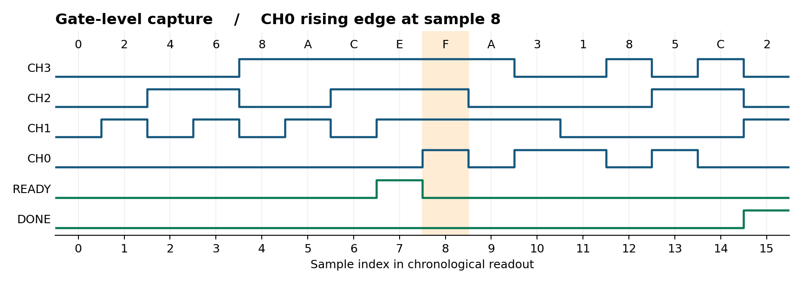

# TinyScope-16 · Post-route timing and readout MUX study

TinyScope-16 captures four digital inputs into a 16-word circular buffer. Eight samples precede the selected CH0 edge, the trigger occupies address 8, and seven samples follow. The record freezes for asynchronous indexed readout. This study compares the original indexed read with four candidate read banks. Both use the same 64 storage bits and the same capture protocol.

## Baseline on SKY130

The submission artifact identifies commit `f3f16c4668ffa2a5b1e75e7e4c0edd2f7e2899e7`. LibreLane 3.0.14 used sky130A / open_pdks `8afc8346a57fe1ab7934ba5a6056ea8b43078e71`. The GDS, precheck and gate-level jobs succeeded. The Pages viewer deployment failed separately. A second workshop build of the same commit reproduced all the metrics below. [Canonical run](https://github.com/HowardLee07/tiny_tape_out_Howard/actions/runs/44818237359) · [Workshop run](https://github.com/HowardLee07/tqt_tt_workshop_ex/actions/runs/44815488059)

| Baseline measurement | Result |
| --- | --- |
| Final SDC clock / project metadata clock | 20 ns (50 MHz constraint) / 1 MHz nominal |
| Tile / core | 161.00 × 111.52 µm / 16,493.3 µm² core |
| Synthesis | 312 mapped cells, 4,095.18 µm² |
| Post-route standard cells | 669, including 86 sequential cells and 225 tap cells |
| Standard-cell area / core utilization | 5,748.01 µm² / 34.85% |
| Worst setup slack / corner | +4.957389 ns / max RC, SS, 100 °C, 1.60 V |
| Worst hold slack / corner | +0.115527 ns / min RC, FF, −40 °C, 1.95 V |
| Setup / hold TNS | 0 / 0 ns across nine analyzed RC/PVT combinations |
| Final router DRC / Magic DRC / LVS errors | 0 / 0 / 0 |
| Peak corner violation counts, slew / fanout / cap | 40 / 1 / 0 |

**Setup.** The limiting path starts at external read-address bit 0 (`ui_in[5]`) and ends at read-data bit 3 (`uo_out[3]`). The mapped path crosses read-address logic, a fanout buffer, a 4:1 MUX, two 2:1 MUXes and the output gate. The 4 ns input allowance plus 6.792611 ns of on-chip delay gives 10.792611 ns arrival. With 4 ns output allowance and 0.25 ns uncertainty, the required arrival is 15.750001 ns. The clock constraint and this input-to-output path alone do not establish a maximum silicon sampling rate. The summary reports the separate register-to-register setup metric as N/A.

**Hold and electrical limits.** The shortest reported hold path runs from `wr_addr[2]` to `start_addr[2]`. One slow-corner MUX select pin (`_243_/S0`) sees 1.394118 ns transition against a 0.750 ns limit. The CTS root buffer `clkbuf_0_clk/X` drives 16 loads against a limit of 10. These are open electrical checks even with positive setup and hold slack. In any follow-up run, inspect the read-select fanout and clock tree separately. Compare post-route checks before selecting a change for submission. [Path excerpts](evidence/paths.txt) · [Nine-corner summary](evidence/corners.txt) · [Metrics CSV](evidence/metrics.csv)

## Verification and layout

The cocotb regression checks both trigger polarities at all 16 ring offsets (32 captures), all 16 read addresses, prefill behavior, re-arm, reset during capture and record invalidation. The baseline CI gate-level simulation passed both tests. The plot decodes the final directed capture from that gate-level FST. At each rising edge it shows the sampled inputs and the settled flags. The sixteen frozen words were cross-checked against bus readback in reverse address order. The 40 ns testbench period is independent of the 20 ns implementation constraint.



[Open the routed layout image from the GDS job](evidence/layout.png)

## Controlled readout experiment

A uses `samples[physical_rd_addr]`. B uses the low two address bits within each four-word bank and the high two bits to select a bank. Both pass the same two RTL regressions. A Yosys equivalence check on the capture core proved all 97 compare points, including memory bits and outputs.

| Local comparison | A · indexed | B · four banks |
| --- | ---: | ---: |
| SKY130 HD mapped cells | 226 | 223 |
| Sequential cells | 86 | 86 |
| Sum of Liberty cell areas | 3,464.5728 µm² | 3,464.5728 µm² |

The local mapping used identical TT Liberty, sources apart from the readout, Yosys/ABC commands and tool builds. Counts exclude the Yosys scope marker. This is a separate synthesis experiment from LibreLane. The cell mix changed with zero mapped area savings. B's post-route slack, transition violations and power are still unmeasured. A comparable power study also needs matching activity, frequency and corner. The current data supports keeping A as the submission candidate.

### Reproduce

From the study checkout with OSS CAD Suite active, run the standard tests with `make -B -C test`. Run `study/compare.sh /absolute/path/to/sky130_fd_sc_hd__tt_025C_1v80.lib` for sequential equivalence and the two local mappings. It uses the committed A version and the current checkout for B. The measured tool was Yosys 0.71+59, revision `d9358f38c`. [Pinned Liberty input](https://raw.githubusercontent.com/efabless/skywater-pdk-libs-sky130_fd_sc_hd/5a42fd01a0eeb2338340438443c7062e198d97a4/timing/sky130_fd_sc_hd__tt_025C_1v80.lib)

To complete the physical A/B, run the repository's GDS workflow on `study/readout-mux`. The study branch skips Pages deployment. Download its GDS_logs artifact and the baseline artifact, then run the following from the study checkout.

```sh
python3 study/metrics.py A=baseline-GDS_logs.zip B=banked-GDS_logs.zip
```

Confirm that the new run's resolved configuration, PDK revision, flow version, placement settings and final SDC match the baseline. Inspect the worst paths in each post-route report along with the CSV. If a flow revision changed, rebuild A with that revision before attributing differences to B.
